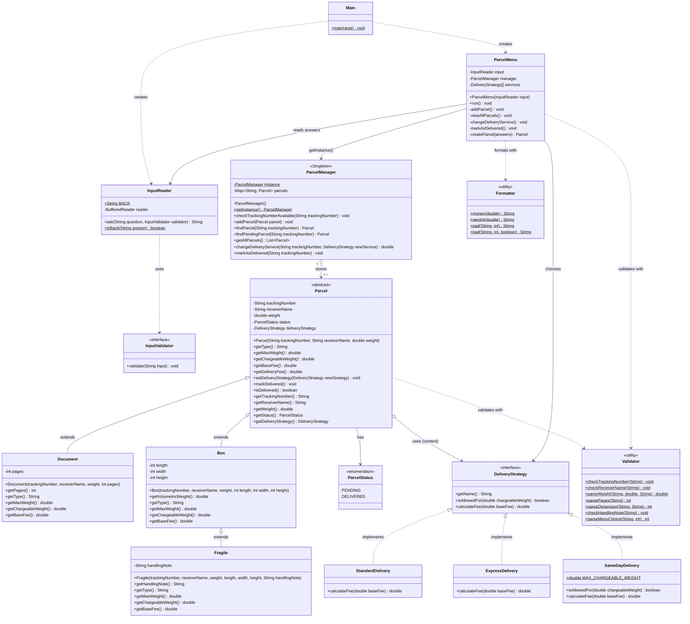

# Parcel Delivery System

A console **Parcel Delivery System** in Java that demonstrates **polymorphism**, **exception handling**, and the **Singleton** and **Strategy** design patterns, together with the other OOP pillars: **encapsulation**, **abstraction** and **inheritance**.

- Runs on **Java 8** (compiled and checked with `javac --release 8`)
- No external libraries
- Opens and runs directly in **VS Code**

---

## Where each concept is used

Every place is also marked in the code with a comment such as `// POLYMORPHISM:` or `// STRATEGY PATTERN:`.

| Concept | Where | How |
|---|---|---|
| **Encapsulation** | `model/Parcel`, `Document`, `Box`, `Fragile` | All fields are `private` and read through getters. There is no setter for the tracking number, receiver or weight. Status and service change only through `markDelivered()` and `setDeliveryStrategy()`, which check the rules first. |
| **Abstraction** (abstract class) | `model/Parcel` | `abstract` class with abstract `getType()`, `getMaxWeight()`, `getChargeableWeight()` and `getBaseFee()`, plus a shared concrete `getDeliveryFee()`. |
| **Abstraction** (interface) | `strategy/DeliveryStrategy`, `ui/InputValidator` | Pure contracts implemented with `implements`. |
| **Inheritance** | `Document extends Parcel`, `Box extends Parcel`, `Fragile extends Box` | Hierarchical (Parcel → Document / Box) and multilevel (Parcel → Box → Fragile) inheritance. Constructors call `super(...)` first, and `Fragile.getBaseFee()` uses `super.getBaseFee() + 100`. |
| **Polymorphism** (runtime / overriding) | `Document`, `Box`, `Fragile`, the three strategies | `@Override` on `getType()`, `getMaxWeight()`, `getChargeableWeight()` and `getBaseFee()`. The menu and manager use only `Parcel` references (`List<Parcel>`), with no `instanceof` and no switch on the type. |
| **Polymorphism** (compile-time / overloading) | `util/Formatter.pad(...)`, exception constructors | The same method name with different parameter lists. |
| **Exception handling** | `exception/*`, `util/Validator`, `ui/*`, `Main` | Custom **checked** exceptions that all extend `ParcelException`, with `throw` / `throws` and `try` / `catch` (most specific first). A nested try-catch wraps `NumberFormatException` and keeps the cause. `Main` uses try-with-resources. |
| **Singleton pattern** | `service/ParcelManager` | `private` constructor plus `static getInstance()` (thread-safe double-checked locking with `volatile`). It is the single shared storage for all parcels. |
| **Strategy pattern** | `strategy/*` with `model/Parcel` as the context | `DeliveryStrategy` interface with `StandardDelivery`, `ExpressDelivery` and `SameDayDelivery`. `Parcel` holds a strategy and delegates `getDeliveryFee()` to it. The strategy is swapped at runtime by **Change Delivery Service**. |

---

## UML class diagram



### Exception hierarchy

```mermaid
classDiagram
    direction TB

    class Exception {
        <<Java built-in, checked>>
    }

    class ParcelException {
        +ParcelException(String message)
        +ParcelException(String message, Throwable cause)
    }

    class InvalidParcelException {
        -String fieldName
        +InvalidParcelException(String fieldName, String message)
        +InvalidParcelException(String fieldName, String message, Throwable cause)
        +getFieldName() String
    }

    class InvalidInputException {
        +InvalidInputException(String message)
    }

    class DuplicateTrackingNumberException {
        -String trackingNumber
        +DuplicateTrackingNumberException(String trackingNumber)
        +getTrackingNumber() String
    }

    class ParcelNotFoundException {
        +String MESSAGE$
        -String trackingNumber
        +ParcelNotFoundException(String trackingNumber)
        +getTrackingNumber() String
    }

    class ParcelAlreadyDeliveredException {
        -String trackingNumber
        +ParcelAlreadyDeliveredException(String trackingNumber)
        +getTrackingNumber() String
    }

    class SameDayNotAllowedException {
        +String MESSAGE$
        -double chargeableWeight
        +SameDayNotAllowedException(double chargeableWeight)
        +getChargeableWeight() double
    }

    Exception <|-- ParcelException
    ParcelException <|-- InvalidParcelException
    ParcelException <|-- InvalidInputException
    ParcelException <|-- DuplicateTrackingNumberException
    ParcelException <|-- ParcelNotFoundException
    ParcelException <|-- ParcelAlreadyDeliveredException
    ParcelException <|-- SameDayNotAllowedException
```



PNG versions: [`docs/class-diagram.png`](docs/class-diagram.png) and [`docs/exception-diagram.png`](docs/exception-diagram.png).

---

## Project structure

```
polymorphism-exception-patterns-exercise/
├── .vscode/
│   ├── launch.json          Run configurations ("console": "integratedTerminal")
│   └── settings.json        Source folders: src, test; output: bin
├── docs/                    UML diagrams (Mermaid source + PNG)
├── src/
│   ├── Main.java            Program entry point
│   ├── model/               Parcel (abstract), Document, Box, Fragile, ParcelStatus
│   ├── strategy/            DeliveryStrategy, StandardDelivery, ExpressDelivery, SameDayDelivery
│   ├── exception/           ParcelException + 6 custom exceptions
│   ├── service/             ParcelManager (Singleton)
│   ├── util/                Validator, Formatter
│   └── ui/                  ParcelMenu, InputReader, InputValidator
└── test/
    └── ParcelSystemTest.java  Self-checking tests (no libraries needed)
```

---

## How to run

### In VS Code
1. Install the **Extension Pack for Java** (Microsoft).
2. Open this folder (**File → Open Folder…**).
3. Open the **Run and Debug** panel and choose **Run Parcel Delivery System**, or open `src/Main.java` and click **Run**.
4. The program runs in the integrated terminal, where you can type your answers.

To run the tests, choose **Run Tests** in the same panel.

### From a terminal (Windows, macOS or Linux)
```bash
javac -d bin -sourcepath src src/Main.java
java -cp bin Main
```

Tests:
```bash
javac -d bin -sourcepath src test/ParcelSystemTest.java
java -cp bin ParcelSystemTest
```

---

## Fee rules

| Parcel | Max weight | Chargeable weight | Base fee |
|---|---|---|---|
| Document (1–100 pages) | 0.5 kg | actual weight | Php 50 flat |
| Box (L, W, H in cm) | 50 kg | bigger of actual and (L×W×H)/3500, rounded **up** to a whole kg | Php 40 × chargeable weight |
| Fragile (extends Box, + handling note) | 30 kg | same rule as Box | Box base fee + Php 100 |

| Service | Delivery fee |
|---|---|
| Standard | base fee |
| Express | base fee × 1.5 |
| Same Day | (base fee × 2) + Php 100, only if chargeable weight ≤ 10 kg |

**Example:** FRAGILE, 40 × 20 × 10 cm, 1.8 kg, EXPRESS
Volumetric weight = 8000 / 3500 = 2.29 kg → chargeable weight 3 kg
Base fee = (Php 40 × 3) + Php 100 = Php 220
Delivery fee = Php 220 × 1.5 = **Php 330.00**

---

## Using the program

```
--------------- MAIN MENU --------------
1. Add Parcel
2. View All Parcels
3. Change Delivery Service
4. Mark as Delivered
5. Exit
```

- **Navigation:** type `\` at any prompt to go back one question. On the first question of an operation it returns to the main menu. On the main menu it shows *"You are already at the main menu."*
- **Invalid input:** shows `[Invalid]` and the reason, then asks the **same** question again.
- **Exact input:** answers are read exactly as typed. For menu choices `1` is accepted, but `01`, ` 1`, `1 ` or extra characters are rejected.

### Validation rules
| Field | Rule |
|---|---|
| Tracking number | exactly uppercase `ABC` + 4 digits (e.g. `ABC0001`), unique |
| Receiver name | letters only, one space allowed between words, not empty |
| Weight | digits with an optional decimal point (no letters, signs or spaces), > 0, ≤ the type's maximum |
| Pages | whole number 1 to 100 |
| Length / width / height | whole numbers > 0, no leading zeros |
| Handling note | not empty, not only spaces |

### Sample session
```
Enter your choice: 1

--- ADD PARCEL ---
(Type \ to go back one question.)
Select parcel type:
  1. Document
  2. Box
  3. Fragile
Enter choice: 3
Enter tracking number (e.g. ABC0001): ABC0001
Enter receiver name: Juan Dela Cruz
Enter weight in kg (max 30 kg): 1.8
Enter length in cm: 40
Enter width in cm: 20
Enter height in cm: 10
Enter handling note: Handle with care
Chargeable weight: 3 kg
Select delivery service:
  1. Standard
  2. Express
  3. Same Day
Enter choice: 2
Parcel added successfully! Delivery fee: Php 330.00
```

```
--- ALL PARCELS ---
+--------------+----------+----------------+-------------------+----------+--------------+-----------+
| Tracking No. | Type     | Receiver       | Chargeable Weight | Service  | Delivery Fee | Status    |
+--------------+----------+----------------+-------------------+----------+--------------+-----------+
| ABC0001      | Fragile  | Juan Dela Cruz |              3 kg | Express  |   Php 330.00 | Pending   |
| ABC0002      | Box      | Ben Reyes      |             36 kg | Standard |  Php 1440.00 | Pending   |
| ABC0003      | Document | Maria Santos   |            0.3 kg | Same Day |   Php 200.00 | Delivered |
+--------------+----------+----------------+-------------------+----------+--------------+-----------+
Total parcels: 3
```
